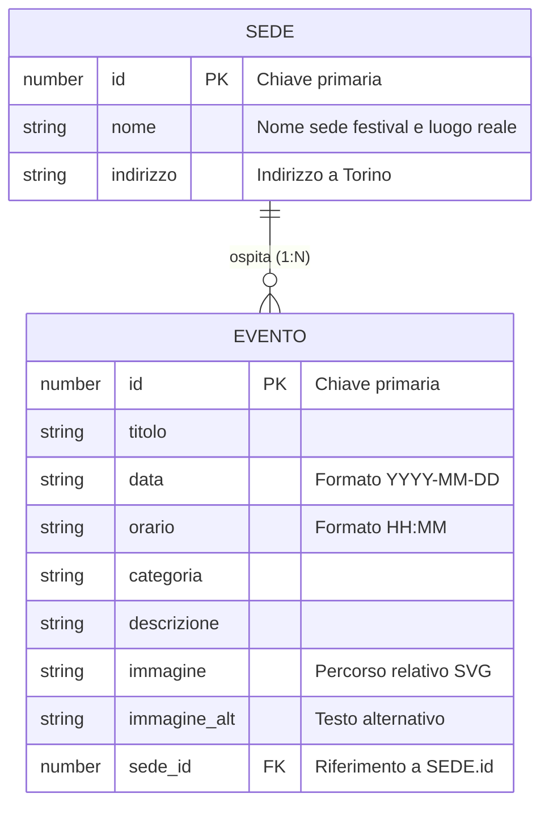

# Schema dei dati — Segnale

Questa scheda documenta la struttura dei dati del festival immaginario **Segnale**, basata sui file JSON presenti nella cartella `dati/` e sui contenuti delle sedi del sito.

## 1. Entità

Il modello dati è composto da due entità principali:

* **Evento**: descrive i singoli appuntamenti del festival (incontri, laboratori e mostre).
* **Sede**: descrive i luoghi di Torino che ospitano gli appuntamenti.

---

## 2. Campi delle entità

### Entità: `Evento`
*(File sorgente: `dati/eventi.json`)*

| Campo | Tipo | Descrizione | Esempio |
| :--- | :--- | :--- | :--- |
| `id` | `number` | Identificativo numerico univoco dell'evento | `1` |
| `titolo` | `string` | Titolo dell'appuntamento | `"Lettere in movimento"` |
| `data` | `string` | Data dell'evento in formato ISO (`AAAA-MM-GG`) | `"2026-06-12"` |
| `orario` | `string` | Ora di inizio dell'appuntamento (`HH:MM`) | `"10:00"` |
| `categoria` | `string` | Tipologia di attività (`Incontro`, `Laboratorio`, `Mostra`) | `"Incontro"` |
| `descrizione` | `string` | Breve testo descrittivo dell'evento | `"Come cambia un messaggio quando cambiano le lettere? Un incontro su tipografia, ritmo e comunicazione visiva."` |
| `immagine` | `string` | Percorso relativo dell'illustrazione associata | `"assets/lettere-in-movimento.svg"` |
| `immagine_alt` | `string` | Testo alternativo accessibile per l'immagine | `"Lettere geometriche disposte su una griglia"` |
| `sede_id` | `number` | Chiave esterna che collega l'evento alla sede ospitante | `1` |

### Entità: `Sede`
*(File sorgente: `dati/sedi.json`)*

| Campo | Tipo | Descrizione | Esempio |
| :--- | :--- | :--- | :--- |
| `id` | `number` | Identificativo numerico univoco della sede | `1` |
| `nome` | `string` | Nome della sede nel festival e sede reale di riferimento | `"Officina Nord — Sede centrale"` |
| `indirizzo` | `string` | Indirizzo completo della sede a Torino | `"Corso Duca degli Abruzzi 24, Torino"` |

---

## 3. Chiavi primarie

* **`Evento.id`**: valore numerico intero (`1–6`), univoco nell'entità `Evento` e stabile.
* **`Sede.id`**: valore numerico intero (`1–3`), univoco nell'entità `Sede` e stabile.

---

## 4. Relazione

Tra `Sede` ed `Evento` esiste una relazione **uno-a-molti (`1:N`)**:

* Una **Sede** può ospitare più **Eventi** (nel programma completo sono previsti due eventi per ogni sede).
* Ogni **Evento** si svolge in una sola **Sede**.
* Il collegamento avviene tramite **`Evento.sede_id`**, che fa riferimento a **`Sede.id`**.

---

## 5. Quantità

* **Eventi**: `6` appuntamenti complessivi (3 per venerdì 12 giugno 2026 e 3 per sabato 13 giugno 2026).
* **Sedi**: `3` luoghi a Torino (`Officina Nord — Sede centrale`, `Spazio Forma — Politecnico al Valentino`, `Cortile Comune — Sede di Mirafiori`).

---

## 6. Chi aggiorna i dati e come

* **Chi aggiorna i dati**: lo studente o il gruppo che cura il progetto didattico.
* **Come avviene l'aggiornamento**: modificando direttamente i file `dati/eventi.json` e `dati/sedi.json` nella repository locale, verificando il risultato nel browser e pubblicando le modifiche tramite commit e push sul repository remoto.

---

## 7. Che cosa mostra la pagina

La pagina `programma.html` legge i dati dai file JSON, risolve il riferimento `Evento.sede_id` con `Sede.id` per ottenere il nome completo della sede e genera dinamicamente nella griglia le **6 schede degli appuntamenti**. Ogni scheda mostra:

* Illustrazione (`immagine`) con relativo testo alternativo (`immagine_alt`);
* Data formattata, orario e categoria (`data`, `orario`, `categoria`);
* Titolo (`titolo`) e testo descrittivo (`descrizione`);
* Nome della sede ospitante (`Sede.nome`).

---

## Schema Evento–Sede

